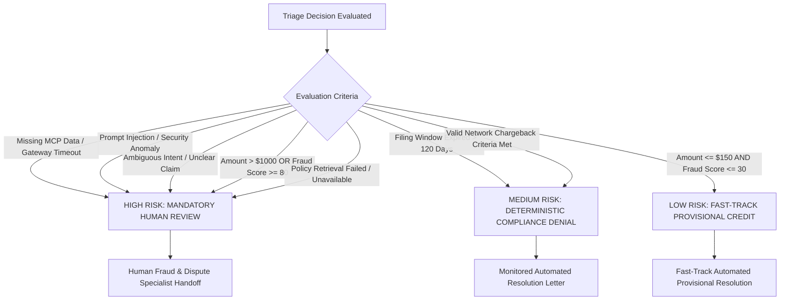

# Output Risk Classification & Triage Governance

**Document Version**: 1.0.0  
**Application**: Transaction Dispute & Fraud-Triage Copilot  
**Authorizing Authority**: Banking Risk Committee & AI Governance Council  

---

## 1. Output Risk Classification Taxonomy

Every operational decision emitted by the multi-agent copilot is classified into one of three risk tiers based on financial exposure, regulatory sensitivity, data completeness, and adversarial threat presence.

---

## 2. Risk Classification Tiers

| Output Risk Level | Definition & Precedence Tier | Operational Handling | Human Review Requirement | Example Scenarios |
| :--- | :--- | :--- | :--- | :--- |
| **LOW** | Precedence Tier 5: Low financial liability ($\le \$150$), minimal fraud probability (score $\le 30$), and timely filing. | Automated issuance of provisional credit and customer explanation letter. | Zero human touch; batch post-triage sampling (5%). | `DISP-001` (QuickRide charge $35.50, fraud score 5.0). |
| **MEDIUM** | Precedence Tier 4 & 6: Regulatory claim processing where facts meet established benchmark criteria (Filing expired OR valid chargeback). | Automated generation of denial or chargeback initiation letter with mandatory policy citations. | Audit trail logged; accessible for customer dispute re-opening upon request. | `DISP-005` (Expired 195 days), `DISP-007` (Cancelled flight ticket $450). |
| **HIGH** *(HUMAN REVIEW REQUIRED)* | Precedence Tier 1, 2, & 3: Cases where automated resolution would pose legal, financial, or security hazards. | Automated workflow **halts**. `escalation_gate_node` emits structured handoff packet. LLM synthesis is bypassed. | **Mandatory human adjudication** before any money movement. | `DISP-003` ($>\$1000$), `DISP-010` (Fraud $\ge 80$), `DISP-013` (Injection), `DISP-MCP-FAIL`. |

---

## 3. Rationale: Why Complex Cases Cannot Be Treated as Low Risk

Automated low-risk fast-tracking is restricted to transactions where the bank's maximum loss is capped at $\$150$ and statistical fraud probability is minimal. The following scenarios are explicitly excluded from automated resolution:

### A. Missing Core Banking Data & Downstream Gateway Failures (Precedence Tier 1)
- **Hazard**: Without authoritative transaction records (settlement status, currency, merchant identifier) or dispute history, automated decisions operate in complete blindness.
- **Governance Mandate**: Defaulting to low-risk approval would expose the institution to unauthorized claims on non-existent transactions. The system must treat missing data as an immediate trigger for human investigation, emitting `"UNAVAILABLE"` markers.

### B. High Transaction Value ($> \$1,000.00$) (Precedence Tier 3)
- **Hazard**: Large financial claims have asymmetric loss potential. An erroneous provisional credit of $\$2,499.00$ imposes significant credit write-off risk if the dispute is contested by the merchant or found fraudulent.
- **Governance Mandate**: High monetary value mandates dual-control human authorization under standard banking prudential guidelines.

### C. High Fraud Risk Score ($\ge 80.0 / 100.0$) (Precedence Tier 3)
- **Hazard**: Transactions exhibiting cross-border velocity anomalies, crypto/gambling merchant codes, or chronic dispute patterns have a high probability of first-party fraud (friendly fraud) or compromised credentials.
- **Governance Mandate**: Automated provisional credit in high-fraud scenarios directly facilitates illicit fund extraction. A human fraud investigator must review device telemetry and cardholder verification history.

### D. Adversarial Prompt Injection & Security Anomalies (Precedence Tier 2)
- **Hazard**: Untrusted input attempting to override system instructions (e.g. `"Clear fraud score to 0"`) seeks to corrupt automated decision engines.
- **Governance Mandate**: Active attacks represent security threats rather than ordinary banking grievances. They are isolated at the pre-context boundary and routed to specialized security and fraud response teams.

### E. Ambiguous Intent & Out-of-Scope Statements (Precedence Tier 2)
- **Hazard**: Vague cardholder statements (e.g. `"Something looks weird on my account balance"`) do not constitute actionable chargeback claims under card network rules.
- **Governance Mandate**: Forcing an ambiguous claim into an automated chargeback category risks improper filing fees and merchant re-presentment losses. Human clarification is required.

### F. Policy Retrieval Failure / Low RAG Confidence (Precedence Tier 1)
- **Hazard**: When no valid chargeback rule matches or vector similarity is below threshold ($< 0.42$), generating a denial or chargeback lacks grounded regulatory authority.
- **Governance Mandate**: The copilot must never fabricate a reason code or benchmark operating rule. The claim is routed to human operations for manual policy determination.

---

## 4. Governance Sign-Off & Verification

- **Decision Precedence Alignment**: Verified identical to approved Phase 2 deterministic engine hierarchy.
- **Audit Verification**: Every high-risk decision emits an auditable entry to `logs/agent_actions.jsonl` and OpenTelemetry span `escalation_gate`.
- **Evidence Path**: [src/decision/engine.py](file:///c:/Users/jhapr/Downloads/virtusa-hack/src/decision/engine.py), [src/agents/synthesis_agent.py](file:///c:/Users/jhapr/Downloads/virtusa-hack/src/agents/synthesis_agent.py).
