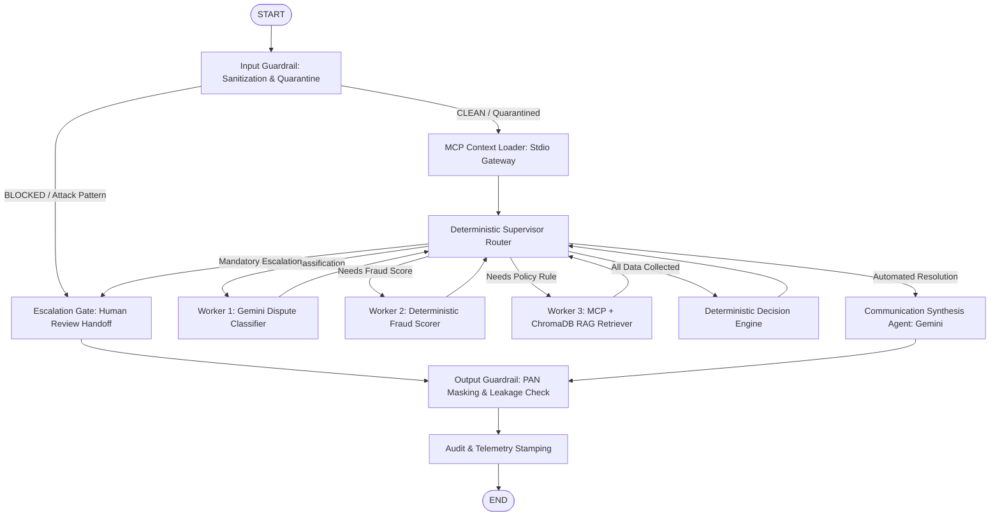

# System Card: Multi-Agent Transaction Dispute & Fraud-Triage Copilot

**System Name**: Cardholder Dispute & Fraud-Triage Multi-Agent System  
**System Version**: 3.0.0 (Phase 3 Enterprise Production Architecture)  
**Deployment Profile**: On-Premises / Air-Gapped Python Virtual Environment (Zero Docker, Zero External DBs)  
**Primary Function**: Automated cardholder dispute intake, fraud anomaly scoring, benchmark policy retrieval, deterministic triage decisioning, and customer resolution synthesis.

---

## 1. System Topology & Architectural Blueprint

The copilot is implemented as an asynchronous state graph utilizing LangGraph, backed by persistent SQLite session checkpointing. The system maintains strict trust boundaries between untrusted customer input and internal banking tools.

---

## 2. Specialized Subsystems & Node Contracts

### A. Input Guardrail (`input_guard`)
- **Trust Boundary**: Sits on the ingestion edge before any banking context is loaded.
- **Functions**: Regex sanitization of 16-digit PANs and 10-12 digit account numbers; detection of instruction-injection / system-override attacks; structured XML quarantine wrapping (`<customer_untrusted_claim>`).
- **Contract**: Emits `quarantined_text` and `guardrail_flags`. If security violation is detected, immediately sets `escalation_required=True` and routes to `escalation_gate`.

### B. Core Banking MCP Client (`mcp_client`)
- **Transport**: Standard Input/Output (`stdio`) subprocess transport connecting to `mcp_server/server.py` via `langchain-mcp-adapters`.
- **Tools**:
  - `get_transaction_details`: Retrieves amount, merchant, masked PAN, timestamp, currency.
  - `get_customer_dispute_history`: Retrieves prior disputes count, open disputes, win rate, tenure.
- **Resource**:
  - `dispute-policy-spec://network_rules`: Exposes synthetic network regulation metadata catalog.
- **Failure Behavior**: Emits structured errors (404 Not Found, 504 Gateway Failure) without throwing unhandled exceptions.

### C. Deterministic Fraud Scorer (`fraud_scorer`)
- **Zero-LLM Design**: Pure deterministic feature evaluation in `src/fraud/scorer.py`.
- **Features Evaluated**:
  1. Transaction amount relative to threshold ($>\$1000 \rightarrow +30$).
  2. Transaction type (Card-not-present / ecommerce with amount $\ge \$200 \rightarrow +20$).
  3. High-risk merchant category (Crypto / foreign exchange / wire transfer $\rightarrow +35$).
  4. Cross-border transaction ($\rightarrow +15$).
  5. Chronic dispute history ($>3$ disputes $\rightarrow +25$).
- **Output**: Numeric score $0.0 - 100.0$, categorical risk tier (`LOW`, `MEDIUM`, `HIGH`, `CRITICAL`), and identified risk factors.

### D. Policy Retrieval Agent (`chargeback_retriever`)
- **Hybrid Retrieval**: Queries MCP resource for candidate rule filtering + local ChromaDB vector similarity search with sentence-transformer embeddings.
- **Confidence Gate**: Calibrated threshold ($\ge 0.42$). If confidence $< 0.42$ or category mismatch occurs, sets `policy_retrieval_failed=True`.

### E. Deterministic Decision Engine (`decision_engine`)
Evaluates graph state against strict, non-overridable hierarchical banking precedence:
1. **Tier 1**: Required data unavailable or MCP gateway failure $\rightarrow$ `investigate` (Escalate).
2. **Tier 2**: Security anomaly or ambiguous customer intent $\rightarrow$ `investigate` (Escalate).
3. **Tier 3**: Mandatory human thresholds (Amount $> \$1000$, Fraud Score $\ge 80$, or Prior Disputes $> 5$) $\rightarrow$ `investigate` (Escalate).
4. **Tier 4**: Expired synthetic filing window ($>\text{max\_filing\_days}$, e.g. 120 days) $\rightarrow$ `deny`.
5. **Tier 5**: Fast-track low-risk provisional credit (Amount $\le \$150$ AND Fraud Score $\le 30$) $\rightarrow$ `provisional_credit`.
6. **Tier 6**: Valid synthetic chargeback criteria met $\rightarrow$ `chargeback`.

### F. Human Escalation Gate (`escalation_gate`)
- **Zero-LLM Operation**: Emits structured handoff packets for human fraud analysts with zero token consumption.
- **Data Integrity Guarantee**: If core transaction data or fraud scores were unavailable, fields are explicitly formatted as `"UNAVAILABLE"`.

### G. Communication Synthesis Agent (`synthesis`)
- **Model**: Google Gemini Flash via `client.aio.models.generate_content`.
- **Constraint**: Strict `GeminiSynthesisOutput` Pydantic response schema; constrained solely to facts provided by decision engine and retrieved policy.

### H. Output Guardrail (`output_guard`)
- **Function**: Scans all emitted resolution letters and escalation packets for raw payment credentials. Replaces any leaked 16-digit numbers with masked tokens.

---

## 3. Observability & Audit Architecture

1. **OpenTelemetry SDK**: Integrated in `src/observability/tracing.py`. Instruments runs, nodes, MCP tool executions, and Gemini API calls with OpenInference semantic conventions.
2. **Committed Trace Artifact**: `traces/phoenix_spans.jsonl` provides machine-verifiable trace and span records with duration, agent name, tool parameters, and Gemini token accounting.
3. **Machine Logs**:
   - `logs/tool_calls.jsonl`: Auditable record of every MCP tool invocation with latency and status.
   - `logs/agent_actions.jsonl`: Audited record of every guardrail decision (BLOCKED, MASKED, ALLOWED).
4. **State Checkpointing**: Every step is checkpointed in SQLite (`data/eval_checkpoints.sqlite`), allowing complete session replay and post-mortem audit.
